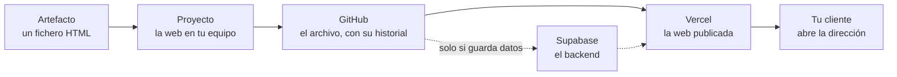

# Módulo 1 · El camino del artefacto a la web

En este módulo ves el camino entero de una vez, con la **propuesta interactiva** (`artefactos/propuesta-interactiva.html`): del fichero que entrega Claude a una web publicada que cualquier cliente abre con una dirección. No hace falta entender cada paso todavía. Los módulos 2 a 5 lo desmontan pieza a pieza, y cada pieza la reconocerás porque ya la habrás visto funcionar.

## Lo que hay en esta rama

Lo mismo que en `main` (el README y los cinco artefactos) más este documento.

## La primera pregunta: ¿solo front, o front y back?

Antes de tocar nada se mira qué hace quien abre el artefacto.

- Si solo lo mira, o elige entre opciones ya escritas y su elección no tiene que quedar guardada, basta con el **front**: la web que se descarga en su navegador.
- Si tiene que quedar constancia de lo que hace, si cada persona debe entrar con su usuario o si hay que guardar ficheros, hace falta además un **backend**.

Con los cinco artefactos del repositorio:

| Artefacto | Qué hace quien lo abre | Qué necesita |
|---|---|---|
| Propuesta interactiva | Elige un plan entre tres | Solo front |
| Calculadora de ahorro | Mueve unos mandos y lee el resultado | Solo front |
| Diagnóstico de madurez en IA | Contesta un cuestionario que el equipo quiere ver después | Front y back (módulo 6) |
| Portal de proyecto | Cada cliente ve solo su proyecto | Front y back |
| Gestión de tareas | Cada persona ve y cambia solo sus tareas | Front y back |

La propuesta es solo front. Por eso es la que recorre el camino en este módulo: entran GitHub y Vercel, y Supabase se queda fuera.

## El camino, en un dibujo

- **GitHub** es el archivo: guarda cada versión, con quién la hizo y cuándo, y deja volver a cualquiera.
- **Vercel** publica el front y le da una dirección que se actualiza sola cada vez que se guarda un cambio.
- **Supabase** pone el backend: la base de datos, los usuarios, los ficheros y la lógica que no puede ir en el navegador. Solo aparece cuando el artefacto lo necesita.

Claude maneja los tres a través de sus **conectores** (MCP): el intermediario que le deja crear un repositorio, publicar una web o preparar una tabla porque se lo pides hablando. Con un servicio sin conector, eso habría que hacerlo a mano en su web.

## El recorrido, de una vez

Esto es lo que verás en directo. Cada paso tiene su módulo, y ahí se explica con calma.

| Paso | Qué se le pide a Claude | Qué sale | Dónde se ve a fondo |
|---|---|---|---|
| 1 | Que abra el artefacto y diga si es solo front | La respuesta de arriba: solo front | Este módulo |
| 2 | Que lo convierta en un proyecto web, con los textos y los datos aparte | Una carpeta con la web, que se ve en el navegador de la app | Módulo 4 |
| 3 | Que lo guarde en un repositorio privado nuevo de GitHub | El repositorio, con su primera versión guardada | Módulo 3 |
| 4 | Que lo publique en Vercel, enlazado a ese repositorio | Una dirección web estable | Módulo 5 |
| 5 | Que cambie un texto y lo guarde | La web publicada se actualiza sola | Módulos 3 y 5 |

La petición de partida es esta:

> Quiero publicar el artefacto `artefactos/propuesta-interactiva.html` como una web. Conviértelo en un proyecto, guárdalo en un repositorio privado nuevo de GitHub y publícalo en Vercel enlazado a ese repositorio. Antes de cada paso, explícame qué vas a hacer y espera a que te diga que sí.

La última frase importa: lo que crea, publica o borra algo, Claude lo propone y una persona lo aprueba. Por qué se trabaja así siempre lo verás en el módulo 7.

## Qué debe salir y cómo sabes que está bien

- [ ] Hay una **dirección web** que se abre en el ordenador y en el móvil.
- [ ] En esa web, al elegir otro plan, **cambian el alcance, el calendario y el precio**, igual que en el artefacto original.
- [ ] En GitHub aparece el **repositorio, privado**, con los ficheros del proyecto.
- [ ] En Vercel aparece el **proyecto enlazado** a ese repositorio.
- [ ] Al cambiar un texto y guardarlo, la web publicada **muestra el cambio** al cabo de un momento, en la misma dirección.

Si algo de esto no se cumple, no se da por bueno: se le dice a Claude qué falta y lo rehace. Lo verás en el módulo 2.

## Tu práctica

En este módulo no hay práctica propia: es la demostración que desmontan los módulos siguientes. Ten a mano la **calculadora de ahorro** (`artefactos/calculadora-ahorro.html`), porque es la que recorrerás tú, paso a paso, del módulo 2 al 5.
