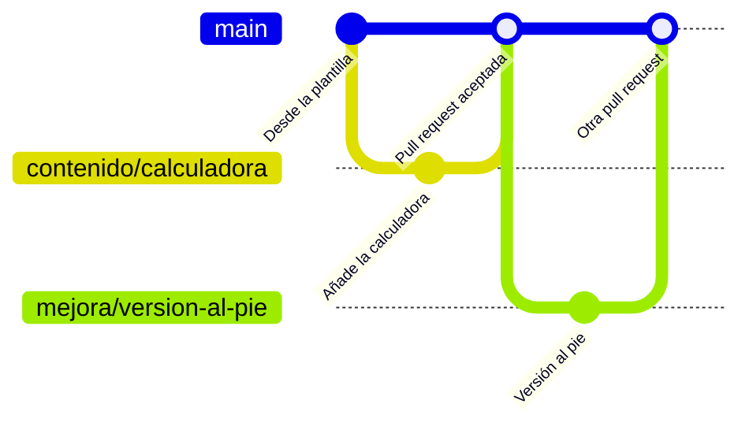

# Módulo 3 · GitHub, el archivo de la empresa

En este módulo guardas un artefacto en un repositorio privado de tu empresa, creado desde la plantilla, haces un cambio en una rama, lo llevas a la principal con una pull request y apuntas una tarea como issue. Todo pidiéndoselo a Claude.

## Lo que hay en esta rama

Lo de la rama `modulo-2/claude-code` más:

- **`plantilla/`**, la plantilla de repositorio de la empresa. Su `README.md` explica cada fichero:
  - `CLAUDE.md`: las normas del equipo, que Claude lee al empezar cada conversación.
  - `.gitignore`: los ficheros que no se suben nunca, como las claves, `.env` y `node_modules`.
  - `.claude/settings.json` y `.claude/hooks/`: el hook que impide guardar o subir cambios en `main`, con sus pruebas.
- **`.claude/skills/issue-dos-niveles/`**, la skill que escribe los issues en dos niveles.
- Este documento.

## Las ideas del módulo, en corto

- **Un repositorio es una carpeta con memoria.** Cada vez que se guarda una versión (un **commit**) queda apuntado qué cambió, quién, cuándo y por qué. Subirla a GitHub es un **push**. Las dos cosas las hace Claude cuando se lo pides.
- **Un repositorio por artefacto, privado, desde la plantilla.** Así cada cliente ve solo lo suyo y cada web se cambia y se publica por separado. El nombre lleva el cliente delante.
- **En `main` no se trabaja.** `main` es lo que se publica para el cliente. Cada cambio va en una **rama**, que es una copia de trabajo, y llega a `main` con una **pull request**: la petición de llevarlo allí, que alguien revisa antes de aceptarla.
- **El hook lo hace cumplir.** Es una comprobación que salta sola antes de cada comando que lanza Claude. Si va a guardar o subir algo en `main`, lo frena, y Claude te explica por qué y te propone una rama. Vigila Bash y PowerShell, porque en Windows Claude puede usar cualquiera de los dos.

Hay tres formas habituales de organizar las ramas:

| Estrategia | Cómo funciona | Cuándo |
|---|---|---|
| **Una rama por cambio** (GitHub flow) | Una rama para cada mejora; se revisa, se acepta la pull request y la rama se borra | Por defecto. Es la del dibujo |
| **Con una rama de pruebas fija** | Los cambios se juntan primero en una rama de pruebas, con su propia dirección, y pasan a `main` cuando el cliente da el visto bueno | Cuando el cliente tiene que aprobar antes de publicar. La dirección de esa rama se pone en el módulo 5 |
| **Git Flow** | Ramas para desarrollo, versiones y correcciones urgentes | Para programas que salen por versiones. Para un artefacto, sobra |

## Una vez por empresa

Esto lo hace quien administra la organización de GitHub de la empresa. Si practicas con tu cuenta personal, sáltate el primer punto y usa tu cuenta donde ponga la organización.

1. **La organización, a punto.** En GitHub, en los ajustes de la organización:
   - Settings › Authentication security › «Require two-factor authentication for everyone in your organization».
   - Settings › Member privileges › Base permissions, en «none» (sin permisos) o en lectura, y acceso por equipos: cada persona ve los repositorios en los que trabaja.
   - Un cliente que tenga que ver su repositorio entra como **colaborador externo** en ese repositorio y en ninguno más.
2. **La plantilla, en GitHub.** Desde una sesión con la carpeta `ArtWeb-curso`, en la rama `modulo-3/github`:

   > Crea en la organización `nombre-de-tu-organización` un repositorio privado llamado `plantilla-empresa` con el contenido de la carpeta `plantilla/` de este repositorio, y márcalo como plantilla.

   Compruébalo en GitHub: en los ajustes de `plantilla-empresa` tiene que estar marcada la casilla «Template repository».

## Tu práctica

Con la **calculadora de ahorro**, la misma que cambiaste en el módulo 2.

Para ponerte en esta rama, abre una sesión con la carpeta `ArtWeb-curso` y pídeselo como en el módulo 2:

> Cámbiate a la rama `modulo-3/github` y dime qué ha cambiado respecto a la anterior.

Las ramas del repositorio del curso no siguen la norma de borrarlas: hay una por módulo y se quedan, porque cada una guarda lo de su módulo. La norma vale para las ramas de tus repositorios.

1. **Crea su repositorio desde la plantilla.** Desde la sesión de `ArtWeb-curso`:

   > Crea un repositorio privado nuevo llamado `gestoria-calculadora-ahorro` a partir de la plantilla `nombre-de-tu-organización/plantilla-empresa` y descárgalo en `Documentos/curso`, al lado de `ArtWeb-curso`.

2. **Abre una sesión nueva con la carpeta `gestoria-calculadora-ahorro`**, en modo Manual. Si la app te pregunta si confías en la carpeta, di que sí: es tu repositorio.

3. **Comprueba el hook.** Estás en `main`, así que esto tiene que fallar:

   > Copia aquí la calculadora de `../ArtWeb-curso/artefactos/calculadora-ahorro.html` y guarda la versión en `main`. Es una prueba: quiero ver que el hook te frena.

   Claude copiará el fichero, intentará guardar la versión y el hook lo frenará. Lo correcto es que te enseñe el mensaje del hook, el de «Bloqueado por la norma del equipo», y te proponga una rama. Si se niega sin intentarlo, porque ya se lo dice el `CLAUDE.md`, la prueba no ha llegado al hook: pídele que lo intente.

4. **Hazlo en una rama, súbela y abre la pull request:**

   > Vale. Crea la rama `contenido/calculadora`, guarda allí la versión, súbela a GitHub y abre una pull request.

   Para abrir la pull request, Claude usa la CLI de GitHub. Si no la tienes, la app te ofrecerá instalarla.

5. **Revisa y acepta.** Abre el enlace de la pull request que te da Claude y mira en «Files changed» qué entra. En un equipo, la acepta otra persona; para practicar, puedes aceptarla tú:

   > Acepta la pull request, borra la rama y vuelve a `main` con lo último.

6. **Apunta un issue.** La skill está en la carpeta del curso, así que primero llévatela a tus skills personales, que valen en cualquier carpeta:

   > Copia la skill `issue-dos-niveles` de `../ArtWeb-curso/.claude/skills/` a mis skills personales.

   Y después:

   > Apunta como issue esta tarea: añadir al pie de la calculadora el número de versión, para que el cliente sepa qué versión está viendo.

   Claude te enseñará el borrador antes de crearlo. Ese issue lo resolverás en el módulo 5.

Otras cosas que puedes pedirle en tu repositorio:

> Enséñame el historial: qué versiones hay, quién las guardó y cuándo.

> ¿Qué cambió en la última versión?

> Quiero volver a como estaba la calculadora en la versión anterior. Hazlo en una rama y abre una pull request.

## Qué debe salir y cómo sabes que está bien

- [ ] En GitHub está `plantilla-empresa`, **privado y marcado como plantilla**.
- [ ] Está tu repositorio `gestoria-calculadora-ahorro`, **privado**, con `CLAUDE.md`, `README.md`, `.gitignore` y la carpeta `.claude`.
- [ ] Al intentar guardar la versión en `main`, **el hook lo frenó** y Claude te enseñó su mensaje.
- [ ] La **pull request** de `contenido/calculadora` traía la calculadora, y al aceptarla la calculadora quedó en `main`.
- [ ] El **issue** tiene dos partes: «Para el equipo», sin jerga, y «Detalle técnico».
- [ ] Si le pides «Pasa las pruebas del hook que protege main», salen todas en verde.

## Lo que el hook no frena

El hook vigila lo que hace Claude, no a las personas. Quien edita un fichero a mano en la web de GitHub, o usa Git por su cuenta fuera de Claude, puede escribir en `main`. Ahí lo que protege es el acuerdo del equipo, el mismo que dice la norma 1 del `CLAUDE.md` de la plantilla.

## Las skills de la empresa

La skill de este módulo vive en la carpeta del curso. En tu empresa, las skills del equipo van juntas en un repositorio privado propio, para que todos usen la misma versión y se sepa quién cambió cada una. Con un plan Team o Enterprise de Claude, ese repositorio, con formato de marketplace de plugins, se sincroniza con la organización de Claude (Organization settings › Plugins & skills › Add › Sync from GitHub) y las skills llegan a todo el equipo: cada vez que se pulsa «Re-sync» o, si se activa «Sync automatically», en cada push a su rama principal.
