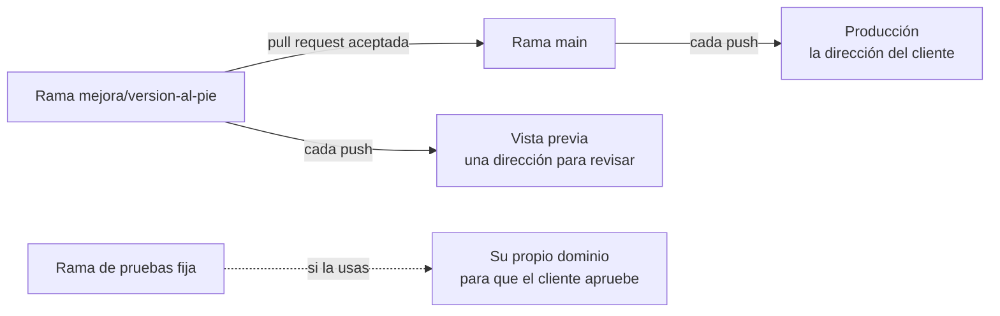

# Módulo 5 · Publicar en Vercel con la cuenta de la empresa

En este módulo publicas un artefacto en una dirección estable de la cuenta de la empresa, revisas una mejora en su vista previa antes de que la vea el cliente, decides quién puede abrirlo y aprendes a volver atrás si una publicación sale mal.

## Lo que hay en esta rama

Lo de la rama `modulo-4/proyecto` más:

- **`web/vercel.json`**: lo que Vercel necesita saber para publicar la web: que es un proyecto de Vite, cómo se instala, cómo se compila y qué carpeta se publica (`dist`).
- **La mejora que se revisa en la vista previa**: el número de versión al pie de la web (`web/src/componentes/Pie.tsx`), con su prueba. Es la tarea que apuntaste como issue en el módulo 3. La versión sale del `package.json` del proyecto, que pasa de la 1.0.0 a la 1.1.0.
- El `README.md` de la web, al día con la publicación.
- Este documento.

## Las ideas del módulo, en corto

- **Una demo y una cuenta de empresa.** El plan gratuito de Vercel (Hobby) solo vale para uso personal y no comercial, y Vercel cuenta como comercial cobrar por crear, actualizar o alojar la web. Lo que se hace para clientes va en el plan Pro o en Enterprise.
- **El proyecto enlazado al repositorio.** Claude crea el proyecto en Vercel con su conector y lo enlaza al repositorio de GitHub. Desde ese momento, lo que entra en `main` se publica solo, siempre en la misma dirección, y cada rama tiene su **vista previa**.
- **Los atajos sin repositorio** sirven para un prototipo, no para un cliente: cada vez que se arrastra un fichero a Vercel Drop se crea un proyecto nuevo, con una dirección nueva.
- **Un dominio propio.** La dirección de Vercel se puede cambiar por un dominio de la empresa. Se añade en el proyecto (Settings › Domains › Add Domain) y se apunta cambiando unos registros DNS en el proveedor del dominio: un registro A para el dominio raíz o un CNAME para un subdominio. Claude te guía, y si el proveedor no tiene conector, basta con pasarle capturas de su panel.
- **Quién puede abrirla.** Una web publicada la abre cualquiera que tenga la dirección, aunque el repositorio sea privado. Vercel puede pedir que quien entre tenga acceso al equipo de Vercel (en todos los planes), crear enlaces para compartir con quien no lo tiene («Anyone with the link»; en Hobby, uno solo en toda la cuenta) o pedir una contraseña, que no existe en Hobby y en Pro se paga aparte por proyecto. Que cada cliente entre con su usuario es el módulo 6.
- **Cuando una publicación sale mal.** Si falla, Claude lee su registro con el conector, encuentra el motivo y lo arregla. Si ha salido pero no está bien, se vuelve a la anterior (Instant Rollback). Ojo: después de volver atrás, lo nuevo que entra en `main` ya no se publica solo hasta que se pulsa **Undo Rollback**. En Hobby solo se puede volver a la inmediatamente anterior; en Pro, a cualquiera que estuvo en producción.

Si usas la estrategia de la rama de pruebas fija (módulo 3), en Vercel se le asigna un dominio propio a esa rama, en todos los planes, y su dirección apunta siempre a su último cambio.

## La demostración: la propuesta de `web/`

El repositorio del curso tiene varias webs en carpetas, y su `main` solo trae los artefactos, sin `web/`. Por eso el proyecto de Vercel se crea con `web` como carpeta raíz (Root Directory) y con `modulo-5/vercel` como rama de producción, que es la rama donde está la web lista para publicar. En un repositorio propio del artefacto, como el tuyo, no hay que tocar ninguna de las dos: la carpeta raíz es la del repositorio y la rama de producción es `main`.

> Crea en Vercel, en el equipo de la empresa, un proyecto enlazado a este repositorio de GitHub, con `web` como carpeta raíz y `modulo-5/vercel` como rama de producción. Antes de crearlo, dime qué vas a hacer y espera a que te diga que sí.

## Tu práctica

Con la **calculadora de ahorro**, en tu repositorio `gestoria-calculadora-ahorro`, que ya tiene el proyecto web en `main` desde el módulo 4. En una sesión con esa carpeta, en modo Manual:

1. **El proyecto en Vercel:**

   > Crea en Vercel, en el equipo de la empresa, un proyecto enlazado a este repositorio, que publique la rama `main`. Antes de crearlo, dime qué vas a hacer y espera a que te diga que sí. Cuando termine, dame la dirección.

   Si Claude te dice que Vercel no tiene acceso al repositorio, falta conectar GitHub con Vercel: pídele que te diga dónde se hace.

2. **Ábrela.** En el ordenador y en el móvil. Mueve los mandos: tiene que funcionar igual que en tu equipo.

3. **La mejora, en su vista previa.** Resuelve el issue que apuntaste en el módulo 3:

   > Resuelve el issue de la versión al pie en una rama y abre la pull request, que diga que cierra ese issue. Dame la dirección de la vista previa de esa rama.

   Abre la vista previa y comprueba que la versión aparece al pie. Abre también la dirección de producción: ahí todavía no está.

4. **Publícala.** Acepta la pull request y espera un momento:

   > ¿Se ha publicado ya en producción? Dame la dirección.

   La versión al pie tiene que aparecer ahora en la dirección de siempre.

5. **Decide quién puede abrirla:**

   > ¿Quién puede abrir ahora esta web? Explícame qué opciones tengo para que solo la vea el cliente y qué cuesta cada una en nuestro plan.

6. **Si algo sale mal** (no hace falta provocarlo):

   > Si la última publicación hubiera salido mal, ¿cómo volveríamos a la anterior? Explícamelo paso a paso, sin hacerlo.

Si tu empresa tiene un dominio, pídele a Claude que te guíe para ponérselo, con los pasos del proveedor del dominio.

## Qué debe salir y cómo sabes que está bien

- [ ] El proyecto está en Vercel, **en el equipo de la empresa**, y **enlazado a tu repositorio** de GitHub.
- [ ] La web se abre en una **dirección estable** y funciona igual que en tu equipo.
- [ ] La rama de la mejora tuvo su **vista previa**, con la versión al pie, mientras producción seguía sin ella.
- [ ] Al aceptar la pull request, **producción se actualizó sola**, en la misma dirección.
- [ ] Al aceptar la pull request, el **issue** de la versión al pie se ha cerrado solo.
- [ ] Sabes quién puede abrir la web ahora y qué harías para que solo la viera el cliente.
- [ ] Sabes cómo se vuelve a la publicación anterior y por qué después hay que pulsar «Undo Rollback».
