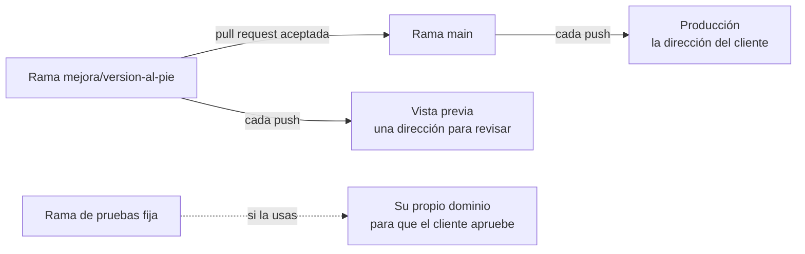

# Módulo 5 · Publicar en Vercel con la cuenta de la empresa

En este módulo publicas un artefacto en una dirección estable de la cuenta de la empresa, revisas una mejora en su vista previa antes de que la vea el cliente, decides quién puede abrirlo y aprendes a volver atrás si una publicación sale mal.

## Lo que hay en esta rama

Lo de la rama `modulo-4/proyecto` más:

- **`web/vercel.json`**: lo que Vercel necesita saber para publicar la web: que es un proyecto de Vite, cómo se instala, cómo se compila y qué carpeta se publica (`dist`).
- **La mejora que se revisa en la vista previa**: el número de versión al pie de la web (`web/src/componentes/Pie.tsx`), con su prueba. Es la tarea que apuntaste como issue en el módulo 3. La versión sale del `package.json` del proyecto, que pasa de la 1.0.0 a la 1.1.0.
- El `README.md` de la web, al día con la publicación.
- Este documento.

## Las ideas del módulo, en corto

- **Una demo y una cuenta de empresa.** El plan gratuito de Vercel (Hobby) solo vale para uso personal y no comercial, y Vercel cuenta como comercial cobrar por crear, actualizar o alojar la web. Lo que se hace para clientes va en el plan Pro o en Enterprise.
- **El proyecto enlazado al repositorio.** Claude crea el proyecto en Vercel con su conector y lo enlaza al repositorio de GitHub. Desde ese momento, lo que entra en `main` se publica solo, siempre en la misma dirección, y cada rama tiene su **vista previa**.
- **Los atajos sin repositorio** sirven para un prototipo, no para un cliente: cada vez que se arrastra un fichero a Vercel Drop se crea un proyecto nuevo, con una dirección nueva.
- **Un dominio propio.** La dirección de Vercel se puede cambiar por un dominio de la empresa. Se añade en el proyecto (Settings › Domains › Add Domain) y se apunta cambiando unos registros DNS en el proveedor del dominio: un registro A para el dominio raíz o un CNAME para un subdominio. Claude te guía, y si el proveedor no tiene conector, basta con pasarle capturas de su panel.
- **Quién puede abrirla.** Una web publicada la abre cualquiera que tenga la dirección, aunque el repositorio sea privado. Vercel puede pedir que quien entre tenga acceso al equipo de Vercel (en todos los planes), crear enlaces para compartir con quien no lo tiene («Anyone with the link»; en Hobby, uno solo en toda la cuenta) o pedir una contraseña, que no existe en Hobby y en Pro se paga aparte por proyecto. Que cada cliente entre con su usuario es el módulo 6.
- **Cuando una publicación sale mal.** Si falla, Claude lee su registro con el conector, encuentra el motivo y lo arregla. Si ha salido pero no está bien, se vuelve a la anterior (Instant Rollback). Ojo: después de volver atrás, lo nuevo que entra en `main` ya no se publica solo hasta que se pulsa **Undo Rollback**. En Hobby solo se puede volver a la inmediatamente anterior; en Pro, a cualquiera que estuvo en producción.

Si usas la estrategia de la rama de pruebas fija (módulo 3), en Vercel se le asigna un dominio propio a esa rama, en todos los planes, y su dirección apunta siempre a su último cambio.

## La demostración: la propuesta de `web/`

El repositorio del curso tiene varias webs en carpetas, y su `main` solo trae los artefactos, sin `web/`. Por eso el proyecto de Vercel se crea con `web` como carpeta raíz (Root Directory) y con `modulo-5/vercel` como rama de producción, que es la rama donde está la web lista para publicar. En un repositorio propio del artefacto, como el tuyo, no hay que tocar ninguna de las dos: la carpeta raíz es la del repositorio y la rama de producción es `main`.

> Crea en Vercel, en el equipo de la empresa, un proyecto enlazado a este repositorio de GitHub, con `web` como carpeta raíz y `modulo-5/vercel` como rama de producción. Antes de crearlo, dime qué vas a hacer y espera a que te diga que sí.

## Tu práctica

**Una vez por empresa.** Quien administra las cuentas deja el equipo de Vercel en el plan Pro, con las personas que van a publicar, conectado a la organización de GitHub y con la protección de partida elegida para los proyectos nuevos. Si practicas con tu cuenta personal, úsala donde ponga «el equipo de la empresa». El recorrido es el mismo, con los límites del plan gratuito: un solo enlace para compartir, sin contraseña y con vuelta atrás solo a la publicación anterior.

Con la **calculadora de ahorro**, en tu repositorio `gestoria-calculadora-ahorro`, tal como la dejaste en el módulo 4.

1. **Abre una sesión nueva** con la carpeta del repositorio, en modo Manual. Lo que se publica es `main`, y la conversión del módulo 4 podía haberse quedado en una rama con su pull request abierta. Si sigue abierta, llévala primero a `main`:

   > Acepta la pull request de la conversión a proyecto, borra su rama y vuelve a `main` con lo último.

2. **Crea el proyecto enlazado:**

   > Crea en Vercel, en el equipo de la empresa, un proyecto para esta web enlazado a este repositorio. Antes de crear nada, explícame qué vas a hacer y espera a que te diga que sí.

   Abre la dirección de producción que te dé, en el ordenador y en el móvil, y mueve los mandos: tiene que funcionar igual que en tu equipo. Si Claude te dice que Vercel no tiene acceso al repositorio, falta darle permiso en GitHub: pídele que te diga dónde se hace.

3. **Mira quién la abre:**

   > ¿Qué protección tiene el proyecto? Dime quién puede abrir la dirección de producción y quién las vistas previas.

   Para practicar, deja las vistas previas con Standard Protection.

4. **Resuelve el issue del número de versión.** En el módulo 3 apuntaste la tarea de añadir al pie de la calculadora el número de versión, y quedó para aquí:

   > Resuelve el issue de la versión al pie en una rama y abre la pull request, que diga que cierra ese issue. Dame la dirección de la vista previa de esa rama.

   Si no llegaste a apuntar el issue, pídelo igual: «Añade al pie de la calculadora el número de versión. Hazlo en una rama, súbela y abre una pull request».

   En la pull request aparecerá el comentario de Vercel con el enlace de la vista previa. Ábrelo y compáralo con producción: en la vista previa está el número y en producción todavía no. Ábrelo también en una ventana privada del navegador, donde te tiene que pedir que inicies sesión en Vercel.

5. **Acéptala:**

   > Acepta la pull request, borra la rama y vuelve a `main` con lo último. Comprueba que el issue se ha cerrado.

   Al cabo de un momento, la dirección de producción enseña el número de versión, y es la misma del paso 2.

   Si quieres ver cómo entraría un cliente sin cuenta, antes de aceptarla crea un enlace para compartir desde Share en la página de la vista previa, ábrelo en la ventana privada y retíralo después con «Only people with access». En Hobby solo hay un enlace para toda la cuenta.

6. **Prepara la vuelta atrás.** No hace falta romper nada para aprenderla:

   > Si la última publicación hubiera salido mal, ¿cómo volveríamos a la anterior? Explícamelo paso a paso, sin hacerlo.

   Y si quieres verla con tus ojos, la calculadora es el sitio. En el panel de Vercel, en la página del proyecto, vuelve a la publicación anterior con el botón de volver atrás: producción se queda sin el número. Después pulsa **Undo Rollback**, elige la publicación nueva, y el número vuelve. Con una calculadora de prueba no pasa nada si algo sale mal.

Otras cosas que puedes pedirle:

> ¿Cuál es la dirección de producción de este proyecto, y cuál la de la última vista previa?

> Enséñame las últimas publicaciones del proyecto y dime cuál está en producción.

> ¿Qué registros DNS tendría que crear para publicarla en `calculadora.tuempresa.com`? No cambies nada todavía.

## Qué debe salir y cómo sabes que está bien

- [ ] En Vercel, en el equipo de la empresa o en tu cuenta, hay un proyecto **enlazado a `gestoria-calculadora-ahorro`**.
- [ ] La **dirección de producción** se abre en el ordenador y en el móvil, y la calculadora funciona igual que en tu equipo.
- [ ] La pull request del número de versión tiene el **comentario de Vercel con su vista previa**, y en ella se ve el número.
- [ ] Esa vista previa, abierta en una ventana privada, **pide iniciar sesión** en Vercel.
- [ ] Tras aceptar la pull request, producción **enseña el número en la misma dirección** que antes.
- [ ] Al aceptar la pull request, el **issue** de la versión al pie se ha cerrado solo.
- [ ] Sabes cómo se vuelve a la publicación anterior y **por qué después hay que pulsar Undo Rollback**.

Si algo de esto no se cumple, no se da por bueno: se le dice a Claude qué falta y lo rehace, como en el módulo 2.
