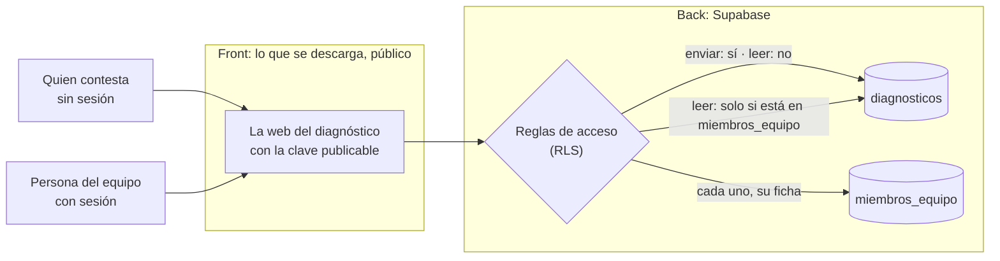

# Módulo 6 · El backend con Supabase

En este módulo le das backend a un artefacto que lo necesita: una base de datos donde se guarda lo que hace quien lo abre, un inicio de sesión y unas reglas que deciden quién ve cada dato. Sin escribir código, y comprobando que las reglas funcionan.

## Lo que hay en esta rama

Lo de la rama `modulo-5/vercel` más:

- **`diagnostico/`**: el diagnóstico de madurez en IA convertido en web y con su backend. Es el resultado de la demostración:
  - `diagnostico/supabase/migrations/`: las tablas, los permisos y las reglas de acceso, como migraciones. El fichero explica arriba, en lenguaje llano, qué permite cada regla.
  - `diagnostico/.env.example`: las dos variables que necesita la web, sin valores reales.
  - `diagnostico/src/lib/supabase.ts`: la conexión con Supabase, que usa solo la clave publicable y se niega a arrancar con la secreta.
  - El panel del equipo, en la dirección `/panel`, con inicio de sesión.
  - Las pruebas, entre ellas una que revisa que las migraciones activan las reglas de acceso en todas las tablas.
  - `diagnostico/README.md`: qué es, quién ve qué y cómo está montado.
- **`.claude/agents/revisor-de-accesos.md`**: el agente que revisa quién puede ver y cambiar cada dato. No cambia nada: informa.
- `.claude/launch.json`, con la web del diagnóstico para verla en la app.
- Este documento.

## Las ideas del módulo, en corto

- **Front y back.** El front es lo que se descarga en el navegador de quien abre la web, y cualquiera puede leerlo: los textos, el diseño y el código. El back está en un servidor: ahí se guardan los datos, se comprueba quién es cada usuario y se usan las claves que nadie debe ver. Lo que va en el front es público, y lo que no deba serlo va en el back.
- **Lo que trae Supabase:** base de datos, usuarios con inicio de sesión (con correo, o con cuentas de Google o Microsoft), ficheros y funciones en servidor.
- **El conector y las migraciones.** Con el conector, Claude crea el proyecto, diseña las tablas y conecta la web. Lo que tú revisas es su propuesta, explicada en lenguaje llano, antes de que la aplique. Cada cambio en la estructura se guarda como una **migración**, un fichero con el paso dado, en `supabase/migrations`, y así el backend tiene historial igual que la web. La integración de Supabase con GitHub, en todos los planes, aplica las migraciones nuevas a producción cuando entran en `main`.
- **Quién ve cada dato.** Las reglas de acceso (RLS, Row Level Security) se escriben en la propia base de datos y se aplican fila a fila. Van **en todas las tablas**: una tabla sin reglas la puede leer y cambiar cualquiera. Se comprueban tres veces: leyendo las reglas, con el asesor de seguridad de Supabase y **desde fuera**, abriendo la web sin sesión e intentando ver lo que no toca.
- **Dos claves.** La **publicable** (`sb_publishable_…`) va en la web y tiene los permisos mínimos: lo que protege los datos son las reglas. La **secreta** (`sb_secret_…`) se salta las reglas, y por eso solo va en un servidor propio: nunca en el navegador ni en el repositorio.
- **Las variables de entorno en una web Vite.** Vite solo deja llegar al navegador las variables que empiezan por `VITE_`. La integración de Supabase con Vercel copia las claves al proyecto de Vercel con otros nombres (`SUPABASE_URL`, `SUPABASE_PUBLISHABLE_KEY`, `SUPABASE_SECRET_KEY`…), ninguno con `VITE_`, así que en Vercel hay que crear `VITE_SUPABASE_URL` y `VITE_SUPABASE_PUBLISHABLE_KEY` con esos mismos valores. La secreta se queda en Vercel y **nunca** se copia con el prefijo `VITE_`.
- **Pruebas y producción.** Un artefacto con datos de clientes tiene dos proyectos de Supabase: uno de pruebas, con datos inventados, y otro de producción. El conector se conecta al de pruebas, acotado a ese proyecto, y se lleva al de producción solo cuando la tarea lo exige, con cada acción aprobada. Nunca se le da a un cliente.
- **Dónde están los datos.** El proyecto de producción se crea en una región concreta de la Unión Europea: Irlanda (eu-west-1), París (eu-west-3), Fráncfort (eu-central-1) o Estocolmo (eu-north-1). La región general «Europe» puede caer en Londres o en Zúrich, que no son de la UE. El contrato de encargo de tratamiento (DPA) forma parte de los términos de Supabase. Elegir región no basta para cumplir el RGPD.
- **El plan.** Lo que vaya a usar un cliente necesita un plan de pago. En el gratuito, un proyecto con poca actividad durante una semana se pausa y no hay copias de seguridad automáticas; en Pro se guardan copias diarias de los últimos siete días.

## La demostración: el diagnóstico, en `diagnostico/`

Con la carpeta `ArtWeb-curso` en la rama `modulo-6/supabase`, en modo Manual y con el conector de Supabase conectado:

1. **El proyecto de pruebas:**

   > Crea en Supabase un proyecto de pruebas llamado `diagnostico-pruebas` en la región de Fráncfort (eu-central-1). Antes, dime qué cuesta.

   No lo aceptes sin leer lo que cuesta.

2. **Las tablas y las reglas:**

   > Explícame en lenguaje llano qué tablas y qué reglas crean las migraciones de `diagnostico/supabase/migrations`. Después, aplícalas al proyecto `diagnostico-pruebas`.

3. **La conexión de la web:**

   > Crea `diagnostico/.env` con la dirección y la clave publicable del proyecto `diagnostico-pruebas`. La secreta no.

4. **Una persona del equipo.** El usuario se crea en el panel de Supabase, en Authentication, con correo y contraseña:

   > Guíame para crear en el panel de Supabase un usuario con correo y contraseña para mí. Cuando esté, dame de alta en la tabla `miembros_equipo` del proyecto de pruebas.

5. **Verla y usarla:**

   > Enséñame el diagnóstico en el navegador de la app.

   Cambia algunas de las respuestas de ejemplo y envíalas con datos inventados. Después abre `/panel`, entra con tu usuario y comprueba que el diagnóstico ha llegado, con su media y su nivel.

6. **La revisión:**

   > Usa el agente revisor-de-accesos sobre el proyecto `diagnostico-pruebas`.

   El informe tiene que decir que quien no ha iniciado sesión no puede leer ningún diagnóstico.

7. **La prueba desde fuera, tú mismo.** Abre `/panel` en una ventana privada, sin iniciar sesión: no se ve ningún diagnóstico. Si creas otro usuario que no esté en `miembros_equipo` y entras con él, el panel te dice que no tienes acceso.

## Tu práctica

Con la **gestión de tareas** (`artefactos/gestion-tareas.html`): ahora cada persona solo hace como que ve sus tareas, porque todas están dentro del fichero. Con backend, de verdad cada persona verá y cambiará solo las suyas. Si te sobra tiempo, repítelo con el **portal de proyecto**: que cada cliente vea solo su proyecto.

1. **Su repositorio**, desde la plantilla, como en el módulo 3: por ejemplo `interno-gestion-tareas`, con el artefacto copiado y en una rama de trabajo.

2. **Su proyecto de pruebas** en Supabase, en una región concreta de la UE, como en el paso 1 de la demostración.

3. **El proyecto y el backend:**

   > Convierte `gestion-tareas.html` en un proyecto web como el del diagnóstico del curso (`../ArtWeb-curso/diagnostico`) y dale backend en mi proyecto de pruebas de Supabase: una tabla de tareas en la que cada persona vea, cree, cambie y borre solo las suyas. Guarda las tablas y las reglas como migraciones en `supabase/migrations`, con RLS en todas las tablas, inicio de sesión con correo y contraseña, y la clave publicable en variables `VITE_` con su `.env.example`. Añade pruebas. Antes de aplicar nada en Supabase, explícame en lenguaje llano qué tablas y qué reglas vas a crear y espera a que te diga que sí.

4. **Dos usuarios de prueba**, con correos inventados (por ejemplo, de `example.com`), creados en el panel de Supabase.

5. **Compruébalo:**
   - Entra como la primera persona, crea dos tareas y cierra la sesión.
   - Entra como la segunda: no ve las tareas de la primera.
   - Sin sesión, no se ve ninguna tarea.

6. **La revisión.** El agente está en la carpeta del curso, así que primero llévatelo a tus agentes personales, como hiciste con las skills:

   > (En la sesión de `ArtWeb-curso`) Copia el agente `revisor-de-accesos` a mis agentes personales, para usarlo en cualquier carpeta.

   Y después, en la sesión de tu repositorio:

   > Usa el agente revisor-de-accesos sobre mi proyecto de pruebas.

7. **Guárdalo:** pruebas y compilación en verde, versión guardada en la rama, pull request y, cuando esté revisada, aceptada.

Si después quieres que una persona de coordinación vea todas las tareas, pídeselo a Claude como una regla más, con su migración, y vuelve a pasar el revisor.

## Qué debe salir y cómo sabes que está bien

- [ ] El proyecto de Supabase es **de pruebas** y está en una **región concreta de la UE**.
- [ ] Las tablas y las reglas están **como migraciones** en `supabase/migrations`, guardadas en el repositorio.
- [ ] **Todas las tablas tienen RLS**, y cada regla dice quién puede hacer qué.
- [ ] En el repositorio hay un `.env.example` **sin valores reales**, y el `.env` **no se ha subido**. Pregúntale a Claude: «¿Está el fichero .env en el repositorio?».
- [ ] La web usa la **clave publicable**. La secreta no aparece en ningún fichero.
- [ ] Cada persona ve **solo lo suyo**, y sin sesión **no se ve nada**.
- [ ] El **revisor de accesos** no encuentra nada grave, y el asesor de seguridad de Supabase no da avisos sin explicar.
